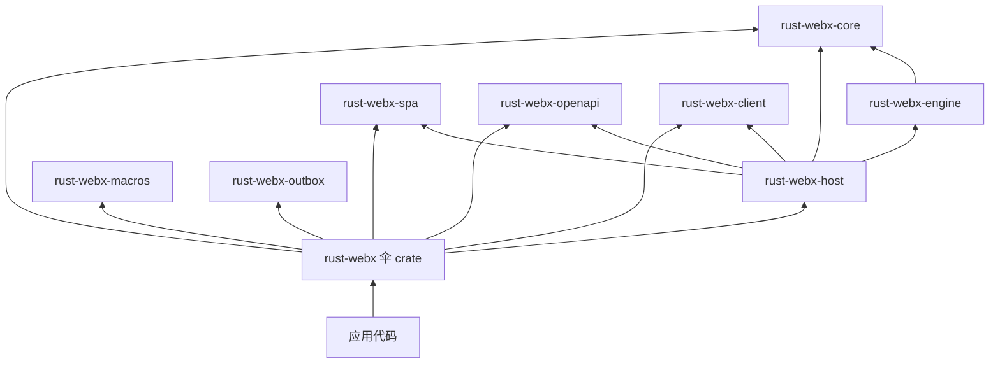

# 生态与 Crate 全景

> 本页是**生态地图与选型入口**：说明有哪些 crate、什么时候需要它们，以及依赖方向。
> 每个 crate 的包名、导入名、职责与公开能力以
> [Crate 分层结构](../04-architecture/crate-layout.md) 为唯一权威；本页不再重复逐 crate 的
> API 清单，避免版本演进时出现第二套描述。

## Workspace 总览

rust-webx 以 Cargo workspace 组织。`crates/` 下是 **30 个可发布 crate**：

```text
rust-webx/
├── crates/
│   ├── core/  host/  engine/  macros/  spa/  openapi/
│   ├── client/  outbox/  build/  webx/
│   ├── ai/{core,gateway}
│   ├── auth/{mfa,oauth2,oidc,webauthn}
│   ├── cache/redis
│   ├── queue/{nats,rabbitmq,kafka}
│   ├── payment/{core,stripe,alipay,wechatpay,paypal,adyen,square}
│   ├── transport/h3
│   └── push/{apns,fcm}
├── examples/{docbit,dmbit,imbit,adapters}   # 参考应用 + 非发布参考适配器
├── testing/{contract-tests,alloc-probe,load-probe,upgrade-smoke}
├── fuzz/                                     # cargo-fuzz 独立 workspace
└── docs/rust-webx/                           # 手册源（mdBook）；book/ 为构建产物
```

包名 / 导入名对照与各层职责见
[Crate 分层结构 §包名与导入名](../04-architecture/crate-layout.md#包名与导入名)。
`examples/adapters/` 与 `testing/` 均**不发布**，不进入 crates.io 发布序列。

## 依赖方向



**关键原则**：

- `core` 只定义契约（trait / 值类型 / 配置），不链接 HTTP 引擎；因此可替换引擎、
  可用纯契约库编写中间件，也便于单元测试 Mock。
- 领域/适配器 crate（AI、认证、缓存、事件传输、支付、推送、HTTP/3）**不进入伞 crate**：
  按需显式依赖，不需要的能力不会进入构建图。
- 所有 `rust-webx*` crate 版本跟随 workspace（同一次发布统一版本号），不单独维护 0.x 线。

## 按场景选 Crate

| 场景 | 需要的 crate | 说明与入口 |
|---|---|---|
| 常规 HTTP/JSON 服务 | `rust-webx`（伞） | 含 core/host/engine/macros/spa/openapi/client/outbox 的常用面；见 [快速上手](../02-quickstart/INDEX.md) |
| 只写独立中间件/契约库 | `rust-webx-core` | 契约层，见 [中间件](../07-middleware/INDEX.md) |
| 静态资源 / SPA 托管 | 伞内 `spa`（无需额外依赖） | `SpaMiddleware` + History fallback；见 [OpenAPI 与 SPA](../11-production/openapi-spa.md) |
| 出站 HTTP（调用第三方 API） | 伞已重导出传输类型；独立库可依赖 `rust-webx-client` | 命名客户端、连接池、流式/SSE；见 [出站 HTTP](../13-extensibility/integrations.md) |
| 事务性 outbox | 伞内 `outbox`；落库参考实现另复制 `examples/adapters/outbox/ef` | 端口/派发器/内存实现；见 [事务性 outbox](../13-extensibility/outbox.md) |
| 多实例实时（WebSocket 续传/在线态/广播） | `rust-webx-redis` + 支持广播的事件传输 | 续传、`IOnlinePresence`、Redis 缓存/事件传输；见 [多实例实时部署](../11-production/realtime-cluster.md)、[已知边界](../../design/known-boundaries.md) |
| 事件传输 | `rust-webx-nats` / `rust-webx-rabbitmq` / `rust-webx-kafka` | 投递语义与广播支持差异见 [broker 能力矩阵](../../design/broker-capability-matrix.md) |
| 登录/MFA/通行密钥 | `rust-webx-mfa` / `rust-webx-oauth2` / `rust-webx-oidc` / `rust-webx-webauthn` | 认证端口与 scheme 装配见 [认证与安全](../09-auth-security/INDEX.md) |
| 移动推送 | `rust-webx-apns` / `rust-webx-fcm` | `IPushSender` 适配器；WebPush 仅端口，见 [推送](../13-extensibility/push-notifications.md) |
| 支付 | `rust-webx-pay` + 所需 provider crate | 统一模型/端口/回调验签；见 [支付](../13-extensibility/payments.md) |
| HTTP/3 | `rust-webx-h3` | 可选监听传输，默认构建不链接 QUIC；见 [传输端口](../../design/transport-port.md) |
| AI 网关 | `rust-webx-ai` + `rust-webx-ai-gateway` | 领域包与 OpenAI 兼容表面分离；不进入伞 crate |
| 构建期内嵌静态资源 | `rust-webx-build`（`build-dependencies`） | 编译期生成资源表；见 [crate 布局 §build](../04-architecture/crate-layout.md) |

各 crate 的公开类型、依赖方向与导入名统一见
[Crate 分层结构](../04-architecture/crate-layout.md)；不要从本页复制 API 细节到业务代码。

## 外部依赖

框架直接依赖的“底座”很少，其余能力以端口 + 可选适配器的形式引入：

| 依赖 | 用途 |
|---|---|
| `rust-core` | `AppError`、分页/结果契约等共享值类型 |
| `rust-dix` | DI 容器、作用域与注入宏 |
| `hyper` + `tokio` | HTTP 监听与异步运行时 |
| `inventory` | 编译期路由/Handler/事件元数据收集 |
| `serde` / `serde_json` | 配置与 JSON |
| `jsonwebtoken` | JWT 编解码 |
| `async-trait` | 异步 trait 支持 |
| `rustls` / `hyper-util` 等 | TLS 与监听栈（随 host/engine 引入） |

可选能力各自引入依赖：`redis`、NATS/RabbitMQ/Kafka 客户端、`rust-ef`（仅参考适配器）、
`p256`/`aes-gcm` 等（WebAuthn/推送适配器）。精确依赖与特性以各 crate 的 `Cargo.toml` 为准。

## 应用开发者视角

通常只需要依赖 `rust-webx` 伞 crate；仅在以下情况直接依赖子 crate：

- 独立中间件/契约库 → `rust-webx-core`
- 多实例实时、事件传输、缓存 → `rust-webx-redis` 或对应 broker crate
- 登录/MFA/通行密钥 → `rust-webx-mfa` / `oauth2` / `oidc` / `webauthn`
- 推送 → `rust-webx-apns` / `rust-webx-fcm`
- 支付 → `rust-webx-pay` + provider crate
- AI 网关 → `rust-webx-ai` / `rust-webx-ai-gateway`
- HTTP/3 → `rust-webx-h3`
- 贡献框架本身 → 修改对应子 crate

## 示例项目

- `docbit`：全栈单体（API + SPA + 文档系统），展示 `#[handler]`、DI、JWT 与 `#[authorize]`；
  运行：`cargo run --manifest-path examples/docbit/Cargo.toml -p docbit-host`
- `dmbit`：设备与库存管理，展示数据层与后台任务。
- `imbit`：实时 IM（WebSocket + 信令 + 浏览器 Cookie 会话/断线续传参考）。
- `examples/adapters/`：与 ORM 耦合的持久化参考适配器（`ai/auth/idempotency/outbox/payment/ef`），
  可复制不可依赖。

## 小结

核心分层是 **core（契约）→ engine（执行）→ host（装配）→ webx（统一开发体验）**，
能力扩展以独立 crate/端口按需引入。想查“某个 crate 到底提供什么、导入名是什么”，
以 [Crate 分层结构](../04-architecture/crate-layout.md) 和对应 rustdoc 为准。

下一章：[快速上手](../02-quickstart/INDEX.md)
