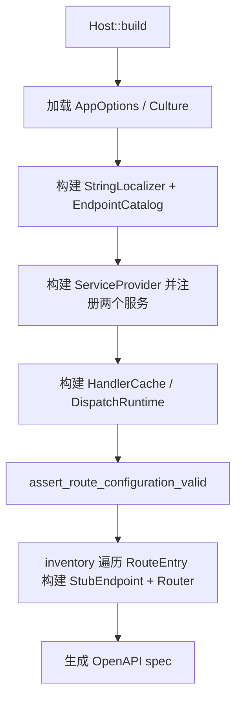

# 编译时扫描机制

## 为什么需要编译时扫描

传统 Rust Web 框架在运行时构建路由表。rust-webx 选择在**编译期**收集元数据，带来：

- 启动时零反射开销
- 遗漏注册在编译期暴露
- OpenAPI 文档可从同一元数据生成

## inventory 机制

框架使用 `inventory` crate 实现编译时收集：

```rust
// 宏展开后大致等价于：
inventory::submit! {
    RouteEntry::new(
        HttpMethod::Get,
        "/hello",
        "HelloRequest",       // handler_type
        "String",             // rsp_type
        TextRef::text("hello"), // name: 资源引用
        TextRef::text(""),      // description
        TextRef::text(""),      // category
        &[],                    // params
        &[],                    // authorization
    )
}
```

每个 `#[get]`、`#[post]` 等宏在展开时向 `inventory` 提交一条 `RouteEntry`。这同一份元数据随后被
`IEndpointCatalog` 与 OpenAPI 消费，不需要再维护第二张路由表。

## Host::build() 扫描流程



## 路由收集

`#[get("/api/users/{id}")]` 宏展开时记录：

| 字段 | 值 |
|------|---|
| HTTP Method | GET |
| Path Pattern | `/api/users/{id}` |
| Request Type | `GetUserRequest` |
| Response Type | `UserDto` |
| Name / Description | `#[display]` / `#[description]` 资源引用（`TextRef`），回退到 `///` |
| Category | `#[category]` 分组标签（可选，`TextRef`） |
| Authorization | `#[authorize]` 规则列表（`AuthorizeRule`） |

## Handler 收集

`#[handler]` / `#[handler(inject)]` 宏展开时向 inventory 提交 `HandlerRegistration`：

| 字段 | 值 |
|------|---|
| Request Type | `HelloRequest` |
| Response Type | `String` |
| Handler Type | `HelloHandler` |
| Factory | 构造 Handler（`Default` 或 DI 注入） |

HTTP 分发通过 `HandlerCache` 查找上述注册项，**不**通过 DI 查找 `dyn IRequestHandler`。

## #[handler(inject)] 与 #[inject]

当 Handler 需要 DI 注入时：

```rust
#[derive(Inject)]
pub struct LoginHandler {
    #[inject(owned)]
    ctx: DbContext,
}

#[handler(inject)]
#[async_trait]
impl IRequestHandler<LoginRequest, AuthResponse> for LoginHandler { ... }
```

`#[derive(Inject)]` 生成构造函数（`get_owned` 解析 bare 字段、`get` 解析 `Arc<T>` 字段）；`#[handler(inject)]` 标记该 Handler 走注入路径而非 Default。

## 授权元数据收集

每个 `#[authorize]` 在编译期收集为一条 `AuthorizeRule`（`roles` / `permissions` 列表），
`RouteEntry.authorization` 保存完整规则组。`StubEndpoint` 在 dispatch 前逐条执行：规则之间 AND，
规则内 any-of；没有规则表示公开。`IEndpointCatalog` 把同一份规则组暴露给权限系统，OpenAPI 与
权限同步不需要再解析宏文本。

`build_resource_policy_from_routes()` 已在 1.0 删除，不再参与 HTTP 分发；`collect_authorizers()` 仍从 DI
收集 `IDynamicAuthorizer`，作为端点的额外动态检查。

> **注意：** `add_authentication()` 仅注册 JWT 中间件，让受保护端点拿到 claims；`#[authorize]` 规则
> 由端点自己执行，不需要额外的策略开关。`resource_auth_middleware` 仅用于自定义
> `IAuthorizationPolicy`，需在路由匹配后使用。详见 [资源授权](../09-auth-security/resource-authorization.md)。

## 注意事项

1. **链接时收集**：`inventory` 依赖链接时合并，确保 Handler 所在 crate 被链接（未被 dead_code 优化掉）
2. **跨 crate**：子 crate 的路由需在该 crate 中被引用（`mod handlers;`）才会参与链接
3. **测试 binary**：集成测试需 `use` 相关模块以触发 inventory 收集

## 小结

编译时扫描是 rust-webx「零配置」体验的技术基石。你写 `#[get]` + `#[handler]`，框架在 `build()`
时自动完成路由表、HandlerCache、`IEndpointCatalog`、本地化资源与 OpenAPI 的关联；配置不一致时
启动即 panic。

下一章：[请求即端点](../05-request-pattern/INDEX.md)
