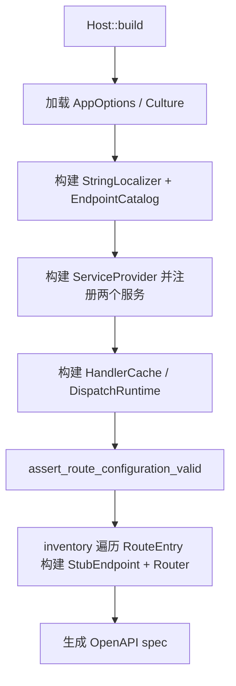

# 编译时扫描机制

## 为什么需要编译时扫描

传统 Rust Web 框架在运行时构建路由表。rust-webx 选择在**编译期**收集元数据，带来：

- 启动时零反射开销
- 遗漏注册在编译期暴露
- OpenAPI 文档可从同一元数据生成

## inventory 机制

框架使用 `inventory` crate 实现编译时收集：

```rust
// 宏展开后大致等价于：
inventory::submit! {
    RouteEntry::new(
        HttpMethod::Get,
        "/hello",
        "HelloRequest",       // handler_type
        "String",             // rsp_type
        TextRef::text("hello"), // name: 资源引用
        TextRef::text(""),      // description
        TextRef::text(""),      // category
        &[],                    // params
        &[],                    // authorization
    )
}
```

每个 `#[get]`、`#[post]` 等宏在展开时向 `inventory` 提交一条 `RouteEntry`。这同一份元数据随后被
`IEndpointCatalog` 与 OpenAPI 消费，不需要再维护第二张路由表。

## Host::build() 扫描流程



`EndpointCatalog` 在 `prepare` 阶段构建：`EndpointCatalog::try_from_inventory()`（`from_inventory()`
是它的历史别名）返回 `Result`，两个路由声明了同一个 `request_id` 时返回 `Error::di`，
`HostBuilder::try_build()` 原样上报，**不会 panic**，也不会生成一张权限键有歧义的目录。

## 路由收集

`#[get("/api/users/{id}")]` 宏展开时记录：

| 字段 | 值 |
|------|---|
| HTTP Method | GET |
| Path Pattern | `/api/users/{id}` |
| Request Type | `GetUserRequest` |
| Response Type | `UserDto` |
| Name / Description | `#[display]` / `#[description]` 资源引用（`TextRef`），回退到 `///` |
| Category | `#[category]` 分组标签（可选，`TextRef`） |
| Authorization | `#[authorize]` 规则列表（`AuthorizeRule`） |

## Handler 收集

`#[handler]` / `#[handler(inject)]` 宏展开时向 inventory 提交 `HandlerRegistration`：

| 字段 | 值 |
|------|---|
| Request Type | `HelloRequest` |
| Response Type | `String` |
| Handler Type | `HelloHandler` |
| Factory | 构造 Handler（`Default` 或 DI 注入） |

HTTP 分发通过 `HandlerCache` 查找上述注册项，**不**通过 DI 查找 `dyn IRequestHandler`。

## #[handler(inject)] 与 #[inject]

当 Handler 需要 DI 注入时：

```rust
#[derive(Inject)]
pub struct LoginHandler {
    #[inject(owned)]
    ctx: DbContext,
}

#[handler(inject)]
#[async_trait]
impl IRequestHandler<LoginRequest, AuthResponse> for LoginHandler { ... }
```

`#[derive(Inject)]` 生成构造函数（`get_owned` 解析 bare 字段、`get` 解析 `Arc<T>` 字段）；`#[handler(inject)]` 标记该 Handler 走注入路径而非 Default。

## 授权元数据收集

每个 `#[authorize]` 在编译期收集为一条 `AuthorizeRule`（`roles` / `permissions` 列表），
`RouteEntry.authorization` 保存完整规则组。`StubEndpoint` 在 dispatch 前逐条执行：规则之间 AND，
规则内 any-of；没有规则表示公开。`IEndpointCatalog` 把同一份规则组暴露给权限系统，OpenAPI 与
权限同步不需要再解析宏文本。

授权规则随端点元数据一起收集；`collect_authorizers()` 从 DI 收集 `IDynamicAuthorizer`，作为端点的
额外动态检查。

### 端点标识与权限目录（`IEndpointCatalog`）

`catalog.all()` 返回 `EndpointDescriptor`，它是权限/菜单/授权管理系统的数据源，字段固定且语言中立：

| 字段 | 用途 |
|---|---|
| `id` | **稳定标识**：`concat!(module_path!(), "::", stringify!(Req))`（如 `docbit_contracts::blog::CreateBlogRequest`），由路由宏自动写入，**不需要开发者加任何属性**。同一进程内必须唯一，见下文“端点 id 唯一性”。 |
| `guid` | 由 `id` 确定性派生的 RFC 4122 v5 GUID（固定命名空间 + SHA-1）；权限表主键首选它：不暴露内部模块路径、定长、跨构建稳定。 |
| `method` / `path` | 自然键（运行时授权看到的 route pattern）；`path` 是声明的 pattern，不是具体请求路径。 |
| `name` / `description` / `category` | `TextRef` 资源引用（`localized()` 才解析成文案），用于菜单与权限项展示。 |
| `authorization` | 声明的 `AuthorizeRule` 列表（roles/permissions，规则间 AND、规则内 any-of）；空 = 公开。 |
| `dynamic` | `true` 表示 `#[authorize(dynamic)]`：规则交给 `IDynamicAuthorizer` 判定。 |
| `requires_auth` | `false` = 公开端点（无 `#[authorize]`）。 |
| `response_type` | OpenAPI 响应类型名，便于与文档对齐。 |

#### 端点 id 唯一性

权限目录按 `id`/`guid` 建键，因此**一个请求类型只能声明一个路由**。重复声明（同一请求类型被两个
路由宏展开，或手工 fixture 复用了 `request_id`）时：

- `EndpointCatalog::try_from_inventory()`（以及历史入口 `from_inventory()`）返回 `Error::di`，
  消息列出每个重复 `id` 及其冲突的 `METHOD /path`，属于 operator 日志信息
  （`public_detail() == None`，不会出现在 HTTP 响应里）。
- `HostBuilder::try_build()` 把该错误原样返回；`HostBuilder::build()` 走既有的 fail-fast 上报，
  **不新增 panic 分支**。
- `--doctor` / `format_route_diagnostics()` 的 “Duplicate endpoint ids” 段落用同一条规则
  （`crate::route::catalog` 内共享），部署前就能看到冲突。

#### `EndpointInfo`：可序列化视图

`EndpointInfo` 是 `localized()` / `localized_for(culture)` 的可序列化视图，直接落库即可做权限种子。
serde 按字段声明顺序输出，字段顺序与语义固定为：

| 顺序 | 字段 | 语义 |
|---|---|---|
| 1 | `id` | 模块限定的请求类型名，**总是序列化**；人类可读的调试键。 |
| 2 | `guid` | 由 `id` 派生的 v5 GUID 字符串，**总是序列化**；外部权限系统主键。 |
| 3 | `method` | 大写 HTTP 方法。 |
| 4 | `path` | 声明的 route pattern。 |
| 5 | `name` | 已解析的端点名称。 |
| 6 | `description` | 已解析的端点描述。 |
| 7 | `category` | 已解析的分组标签；未分类为空串。 |
| 8 | `authorization` | `AuthorizeRule` 列表。 |
| 9 | `dynamic` | 是否 `#[authorize(dynamic)]`。 |
| 10 | `requires_auth` | 是否非公开端点。 |
| 11 | `response_type` | OpenAPI 响应类型名。 |

**外部权限系统以 `guid` 为主键、`id` 为可读调试键；两者都会序列化**（`id` 不会被删除）。
`id` 含内部模块路径：若对接方不能看到内部命名，用 `guid` 落库/传输，`id` 仅用于内部排障
（日志、`--doctor`、`get_by_id` 排查）。数据库以 `guid` 为主键、`(method, path)` 为变更检测键；
**不要**用 route 字符串当权限主键（改路径会丢权限绑定）。GUID 只依赖路由宏生成的 `id`，改路径
不会变，只有改类型/模块才会变，便于权限表迁移。

`all()` 按 `(path, method)` 排序，所以同步是幂等的。

#### OpenAPI 与端点身份对齐

生成的 OpenAPI operation 带两个 additive 扩展键（`x-` 前缀，JSON Schema / OpenAPI 3.0.3 合法）：

```json
{
  "operationId": "createBlogRequest",
  "x-webx-endpoint-id": "docbit_contracts::blog::CreateBlogRequest",
  "x-webx-endpoint-guid": "c316a5b8-d7f5-52a8-872b-2eb152b7d58d"
}
```

- `x-webx-endpoint-id` = `RouteEntry.request_id`，与 catalog 的 `id` 同源。
- `x-webx-endpoint-guid` = `EndpointGuid::from_request_id(request_id)`，与 catalog 的 `guid`
  同一派生算法，可直接与权限表 join。
- `operationId` 仍是面向人的 camelCase 名称（请求类型名去掉 `Request` 后缀），**不承担权限键职责**；
  需要机器可读身份时用扩展键。

> **注意：** `use_authentication()` 仅注册 JWT 中间件，让受保护端点拿到 claims；`#[authorize]` 规则
> 由端点自己执行，不需要额外的策略开关。路由级运行时判定用 `#[authorize(dynamic)]` +
> `IDynamicAuthorizer::authorize_with_declared_rules`（静态声明作为授权器输入）；实例归属仍在
> Handler 内用 `RequestUser::require_owner` / `require_same_tenant` 判定。详见
> [资源授权与实例级归属](../09-auth-security/resource-authorization.md)。

## 注意事项

1. **链接时收集**：`inventory` 依赖链接时合并，确保 Handler 所在 crate 被链接（未被 dead_code 优化掉）
2. **跨 crate**：子 crate 的路由需在该 crate 中被引用（`mod handlers;`）才会参与链接
3. **测试 binary**：集成测试需 `use` 相关模块以触发 inventory 收集

## 小结

编译时扫描是 rust-webx「零配置」体验的技术基石。你写 `#[get]` + `#[handler]`，框架在 `build()`
时自动完成路由表、HandlerCache、`IEndpointCatalog`、本地化资源与 OpenAPI 的关联；配置不一致时
启动即 panic。

下一章：[请求即端点](../05-request-pattern/INDEX.md)
