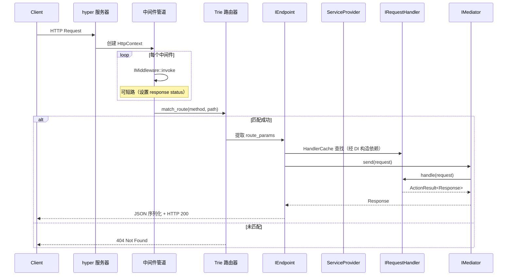
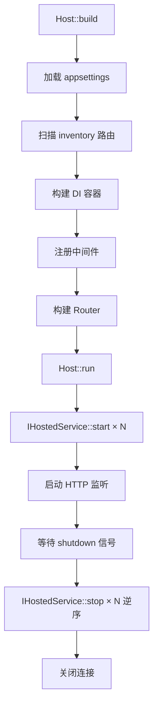

# 请求生命周期

## 全景流程图



## 阶段详解

### 1. 连接与请求读取

2.0 起 `Host::run()` 启动的是 `rust-webx-engine` 的 worker pool：一个 acceptor 在调用方 runtime 上 accept，把连接通过有界 channel 交给 N 个各自拥有 `current_thread` runtime 的 worker（安全 `into_std`/`from_std`，无 `unsafe`），每个 worker 用一个 hyper `auto::Builder` 服务连接。连接不会跨核迁移。

`EngineContext::new()` 不读取 body；body 由 `IHttpRequest::body_bytes()` 按需读取，并强制 `App.MaxBodySize` 限制（默认 10MB）。请求头、method、URI 直接移动/借用 hyper 的 `Parts`，query 只在被访问时解析。

### 2. 中间件管道

中间件按**注册顺序**依次调用。每个中间件可：

- 读取/修改请求头
- 设置认证 claims（JWT 中间件）
- 检查 CORS 预检
- 限流拒绝
- **短路**：设置 response status 后返回，跳过后续处理

### 3. 路由匹配

`Router` 基于 matchit（radix 树）匹配 HTTP method + path：

- 静态段精确匹配
- `{param}` 动态段提取到 `route_params`
- 匹配成功后设置 `route_pattern()`（如 `/api/users/{id}`），供授权使用
- 405/OPTIONS 由 engine 直接写 `Allow`，SPA 只接管真正的 miss（不会把 POST-only 路径伪装成 200）

### 4. 端点处理

`#[handler]` 生成的 `HandlerDispatch` 按 `(请求类型, 响应类型)` 的 `TypeId` 注册；`Host` 启动时把它和 `#[get]` 等路由 join：

1. 先执行静态 `#[authorize]` 规则，再运行已注册的 `IDynamicAuthorizer`（仅限有 `#[authorize]` 的路由）；全部通过才继续
2. 从 route params、query、body 绑定 Request struct
3. 注入 claims，进入 `RequestContext`
4. 若没有注册任何 `IPipelineBehavior`：直接构造 handler 并 `handle(request)`（不经过 `Mediator`、`Box<dyn Any>`、`JsonResult` 装箱）；有 behavior 时回退到 mediated 路径
5. `#[handler(inject)]` 按请求开一个 DI scope；普通 handler 不创建 scope
6. 响应转为 `EndpointResult::{Empty, Json(Bytes), Action(Response)}`，由 engine 写入状态/头/body

### 5. 错误处理

若 Handler 返回 `Err(Error::...)` 或管道中抛出错误，内置异常中间件捕获并映射：

```json
{
  "type": "https://httpstatuses.com/404",
  "title": "Not Found",
  "status": 404,
  "detail": "User abc not found"
}
```

响应头为 `content-type: application/problem+json`（RFC 7807）。

### 6. 响应发送

`HttpResponse` 转为 `hyper::Response`，通过已建立的连接返回客户端。

## 与 Mediator 的关系

对于 `#[endpoint]` / `#[get]` 等宏注册的路由，HTTP 适配层在构造 request 后调用：

```
RouteDispatch → Mediator::send(request) → dispatch → HandlerCache → IRequestHandler::handle
```

`IPipelineBehavior` 在 `dispatch` 内部包装 Handler 调用，实现验证、缓存等横切逻辑。

## DispatchRuntime

每个 `Host` 持有实例级 `DispatchRuntime`（`ServiceProvider` + `HandlerCache`），它只是显式句柄：
HTTP 请求通过 `IHttpContext::dispatch_runtime()` 取得该句柄，宏生成的 `RouteDispatch` 用其中的
provider + registry 构造 `Mediator`；没有 task-local 全局入口。

多 Host 集成测试：`host.dispatch_runtime()` / `host.provider()` 直接使用；后台任务通过注入的
`Arc<dyn ScopeFactory>`（rust-dix 内建）显式 `create_scope()`。

## 启动与关闭生命周期



## 小结

一次 HTTP 请求经历：中间件管道 → 路由匹配 → 端点调度 → Handler 执行 → 序列化响应。理解这条链路是调试和扩展的基础。

下一节：[分层模型与依赖方向](layering-model.md)
