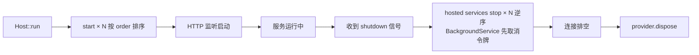

# IHostedService 后台服务

## 接口定义

```rust
#[async_trait]
pub trait IHostedService: Send + Sync {
    async fn start(&self) -> Result<()>;
    async fn stop(&self) -> Result<()> { Ok(()) }  // 默认空实现
    fn order(&self) -> i32 { 0 }                   // 启动顺序，小的先启动、后停止
}
```

## 生命周期时机



- `start()` 在 HTTP 监听器启动**之前**执行，按 `order()` 升序（相同 order 保持注册顺序）；任一服务 `start()` 失败时，已启动的服务按**逆序**回滚 `stop()`，然后 `run()` 返回错误
- 没有 ambient DI：服务若需要 Scoped 依赖（`DbContext`、事务、连接），注入 rust-dix 内建的
  `#[inject] services: Arc<dyn ScopeFactory>`，在 `start()`/后台循环里显式
  `let scope = services.create_scope(); let mut ctx: DbContext = scope.get_owned()?;`，scope 释放即释放依赖
- Host 停机顺序：**hosted services 逆序 stop → 连接排空 → `provider.dispose()`**（rust-dix 逆序释放 singleton 并标记 disposed）
- 监听器**先绑定后启动**：端口占用等绑定错误让 `run()`/`run_at()` 直接返回 `Err`（进程非 0 退出），不会静默"启动成功"
- `stop()` 在优雅关闭、连接排空之前按**启动的逆序**执行（最后启动的最先停止），每个服务最多等待 30s，超时只记日志、不阻塞进程
- `stop()` 只执行一次：shutdown 信号到达时的 watcher 与排空后的收尾共用 `OnceCell`，服务可以安全假设清理逻辑不会被重复调用
- `stop()` 有默认空实现，不需要关闭逻辑可省略

## 典型用途

| 用途 | 示例 |
|------|------|
| 数据库初始化 | `ctx.ensure_created()` 建表 |
| 种子数据 | 默认管理员账户 |
| 索引生成 | DocService 扫描 docs/ |
| 连接池预热 | 预建立数据库连接 |
| 后台消费者 | 消息队列轮询（用 `BackgroundService`） |

## 后台 worker：`BackgroundService` / `PeriodicBackgroundService`

周期性 worker（队列消费者、outbox 发布、定时扫描）不要自己写
`start` + 循环 + `AtomicBool + Notify + JoinHandle` + `stop`：框架提供两层基类，
业务只写一个方法。

### 定时型：`PeriodicBackgroundService`（推荐）

只实现 `interval()` + `tick()`，定时循环、可中断等待、stop/join 全由框架负责：

```rust
use webx::{PeriodicBackgroundService, Result};
use std::time::Duration;

struct OutboxWorker {
    services: Arc<dyn ScopeFactory>,   // rust-dix 内建，无需手动注册
    interval: Duration,
}

#[async_trait::async_trait]
impl PeriodicBackgroundService for OutboxWorker {
    fn interval(&self) -> Duration { self.interval }

    async fn tick(&self) -> Result<()> {
        let scope = self.services.create_scope();   // 每 tick 新 scope
        publish_due(&scope).await
    }
}
```

语义（与手写 runner 一致，便于从项目内 helper 迁移）：

- 第一次 tick 在启动后 **一个 interval**；
- 正在执行的 tick 会先跑完再停（tick 必须短/有界）；
- tick 返回 `Err` 默认**记日志并继续**（轮询型任务要能扛住数据库抖动）；
  需要"失败即停"时覆写 `fn stop_on_error(&self) -> bool { true }`，错误会作为 typed error 从 `stop()` 上报；
- shutdown 立刻中断 interval 等待，60s interval 不会拖慢关闭；
- `interval` 为 0 是配置错误，worker 以 typed error 结束而不是空转。

### 自定义循环：`BackgroundService`

需要「启动即跑一次」或非固定节奏时，实现 `execute`：

```rust
use webx::{background, BackgroundService, CancellationToken, Result};
use std::time::Duration;

struct CustomWorker { /* ... */ }

#[async_trait::async_trait]
impl BackgroundService for CustomWorker {
    async fn execute(&self, ct: CancellationToken) -> Result<()> {
        while !ct.is_cancelled() {
            self.drain().await?;
            // 可中断的等待：cancel 时立刻返回 false
            if !background::delay(&ct, Duration::from_secs(5)).await {
                break;
            }
        }
        Ok(())
    }
}
```

- 启动是**非阻塞**的：worker 在后台任务里跑，host 立即继续启动监听
- 停机时框架先 `ct.cancel()` 再 join；忽略取消的 worker 在 `STOP_GRACE`（5s）后被 abort，不会在
  `provider.dispose()` 之后继续访问已释放的服务
- `execute` 返回 `Err` 是 **typed 失败**：立即记 error 日志，并在 `stop()` 时再次上报；panic 被转成
  `Error::Internal`，不会传播到 host 进程
- 需要每 tick 的 Scoped 依赖（DbContext）时，注入 `Arc<dyn ScopeFactory>` 并在 tick 内开 scope，
  不要把它存到 worker 字段里

## Docbit 实例

`#[derive(Inject)]` 标注 struct 生成构造器，`#[inject]` 标注 `impl IHostedService` 块把实现注册为
`dyn IHostedService`：

```rust
#[derive(Inject)]
pub struct DbInitService {
    #[inject]
    docs: Arc<dyn IDocumentService>,
    /// rust-dix 内建：后台任务自己开 scope
    #[inject]
    services: Arc<dyn ScopeFactory>,
}

#[inject]
#[async_trait]
impl IHostedService for DbInitService {
    async fn start(&self) -> Result<()> {
        // 显式 DI scope：释放 scope 即释放 Scoped 依赖（不落 root）
        let scope = self.services.create_scope();
        let mut ctx: DbContext = scope
            .get_owned()
            .map_err(|e| Error::Internal(format!("DbContext resolution failed: {}", e)))?;

        ensure_schema(&mut ctx).await?;             // 建表
        admin_user::ensure_admin_user(&mut ctx).await?;  // 种子数据
        Ok(())
    }

    async fn stop(&self) -> Result<()> {
        tracing::info!("Shutting down.");
        Ok(())
    }
}
```

替代在 `main()` 中显式调用初始化函数——生命周期由框架统一管理。

## 注册

```rust
Host::builder()
    .register(|svc| {
        svc
            // 1. 常规：要求 Default
            .add_hosted_service::<CacheWarmupService>()
            // 2. 工厂：不要求 Default，构造时从 DI 拿配置/依赖
            .add_hosted_service_with(|resolver| {
                let options = resolve::<CacheOptions>(resolver);
                Arc::new(CacheWarmupService::new(options))
            })
            // 3. 顺序：数值小的先启动、后停止（相同值保持注册顺序）
            .add_hosted_service_ordered::<SeedService>(-100)
            .add_hosted_service_with_ordered(100, |resolver| {
                Arc::new(QueueConsumer::new(resolve::<QueueOptions>(resolver)))
            })
            // 4. 条件注册：配置开关关掉就完全不进容器
            .add_hosted_service_if::<SeedService>(options.seed.enabled)
            .add_hosted_service_with_if(options.outbox.enabled, |resolver| {
                Arc::new(OutboxConsumer::new(resolve::<OutboxOptions>(resolver)))
            })
            // 5. 后台 worker（execute 内自管循环）
            .add_background_service_with(|resolver| {
                Arc::new(OutboxWorker::new(resolver /* ... */))
            })
            .add_background_service_with_if(options.report.enabled, |resolver| {
                Arc::new(ReportWorker::new(resolver))
            })
    })
```

- `add_hosted_service`（旧 API）保持不变，要求 `Default`；
- `add_hosted_service_with` 的工厂在 singleton 构造时调用一次，可以 `resolve::<T>(resolver)` 拿配置或依赖；
- `*_if(enabled, ...)` 只是把条件判断移进框架：`enabled == false` 时服务不注册；
- `BackgroundService` 也可用 `add_background_service::<W>()`（`Default` 构造）；
- `#[inject] impl IHostedService` 仍然可用（rust-dix 注册为 `dyn IHostedService`，order 默认 0）。

## 多个 HostedService

启动按 `order()` 升序（相同 order 按注册顺序），停止按**启动逆序**：

```
注册顺序: DbInit(-100) → CacheWarmup(0) → QueueConsumer(100)
启动顺序: DbInit → CacheWarmup → QueueConsumer
停止顺序: QueueConsumer → CacheWarmup → DbInit
```

## 小结

`IHostedService` 是应用初始化和清理的标准钩子，等价于 ASP.NET Core 的同名接口；
长驻 worker 用 `BackgroundService`，业务只实现 `execute`，取消/join/错误语义由框架提供。

下一节：[模块系统与 inject 宏](module-system.md)
