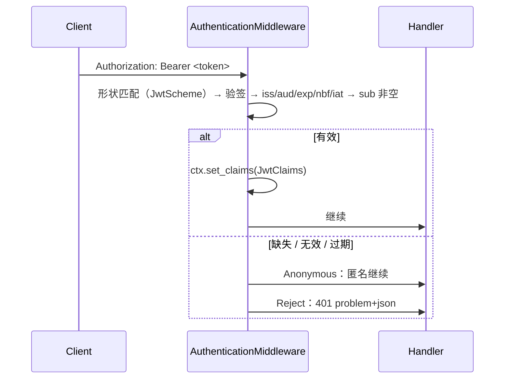

# JWT Bearer 认证

## 一行启用

```rust
Host::builder().add_authentication().build().run().await?;
```

自动：
1. 从 `appsettings.json` 读取 JWT 配置（`Jwt` 节，详见下表）
2. 注册 JWT scheme（由 `AuthenticationMiddleware` 统一调度）
3. 注册默认 `ITokenIssuer`（HS256，登录端点注入即可签发）

`add_authentication()` 只负责 JWT 认证；`#[authorize]` 规则由端点自己执行，未满足时返回 401/403（见 [authorize 宏](authorize-macro.md)）。需要与 `sk-` API Key 共存时见 [API Key 认证](api-key-auth.md)。

## 配置

```json
{
  "Jwt": {
    "Secret": "",
    "SecretFile": "data/jwt.key",
    "ExpirationMinutes": 60,
    "Issuer": "https://id.example.com",
    "Audience": "travel-api",
    "Algorithms": ["HS256"],
    "ClockSkewSeconds": 30,
    "InvalidTokenBehavior": "Anonymous",
    "MaxTokenBytes": 8192
  }
}
```

| 键 | 默认 | 含义 |
|---|---|---|
| `Secret` / `SecretFile` | 空 | HS256 密钥；优先级 `APP__Jwt__Secret`/`JWT_SECRET` > `Secret` > 文件内容 |
| `ExpirationMinutes` | 60 | 默认 issuer 的 token 寿命（`0` 回退默认） |
| `Issuer` | 未设置 | 设置后 `iss` 必须精确匹配 |
| `Audience` | 未设置 | 设置后 `aud` 必须包含该值 |
| `Algorithms` | `["HS256"]` | 接受 `HS256`/`RS256`/`ES256`/`PS256`；非对称算法必须同时配置 `Jwks` |
| `ClockSkewSeconds` | 30 | `exp`/`nbf`/`iat` 的时钟偏移，上限 300 |
| `InvalidTokenBehavior` | `Anonymous` | `Anonymous` = 坏 token 当未登录；`Reject` = 直接 401 |
| `MaxTokenBytes` | 8192 | 超过上限在验签前拒绝，防大 header 分配 |
| `Jwks.Url` | 未设置 | 非对称验签的 JWKS 地址，必须 `https://` |
| `Jwks.CacheSeconds` | 300 | 已取回 JWKS 的缓存时间（1–86400） |
| `Jwks.TimeoutMs` | 2000 | 单次拉取超时（100–10000） |
| `Jwks.MaxKeys` | 32 | 单文档最多使用多少把 key（1–256） |
| `Jwks.AllowPrivateNetworks` | false | 允许内网 JWKS（显式 opt-in；默认拒绝私网/元数据地址） |

配置是 **fail-closed** 的：空 `Issuer`/`Audience`、host 不支持的算法、`ClockSkewSeconds > 300`、`MaxTokenBytes` 为 0 或超过 1 MiB，都会在启动期以 typed error 终止，而不是静默回退。

代码里需要覆盖时：

```rust
Host::builder()
    .add_authentication()
    .use_jwt_validation(
        JwtValidation::builder()
            .require_issuer("https://id.example.com")
            .require_audience("travel-api")
            .invalid_token_behavior(InvalidTokenBehavior::Reject)
            .leeway(Duration::from_secs(30))
            .max_token_bytes(8 * 1024)
            .build()?,
    )
    .build();
```

## 非对称验签与 JWKS

```json
{
  "Jwt": {
    "Secret": "",
    "Algorithms": ["RS256", "ES256"],
    "Issuer": "https://id.example.com",
    "Audience": "travel-api",
    "Jwks": {
      "Url": "https://id.example.com/.well-known/jwks.json",
      "CacheSeconds": 300,
      "TimeoutMs": 2000,
      "MaxKeys": 32
    }
  }
}
```

- 令牌头 `alg` 必须在 `Algorithms` 白名单内；`kid` 交给 `IJwtKeyResolver`。
- `JwksResolver`：缓存已取回的 key；未知 `kid` **只触发一次**刷新（单飞），仍未知 → 401；拉取失败/文档无可用 key → **503 fail-closed**，不会降级成匿名。
- JWKS 文档只接受 `RSA`/`EC(P-256)` 且 `use` 为 `sig`（或缺省）的 key；`alg` 与 `kty` 不符的条目会被跳过。文档大小上限 512 KiB，key 数有上限。
- 拉取走 `rust-webx-client`，默认 SSRF 守卫（私网/链路本地/元数据地址被拒）；`Jwks.Url` 必须 HTTPS。
- HS256 与 JWKS 可共存：`Algorithms: ["HS256","RS256"]` 时，HS256 用 `Jwt.Secret`，RS256/ES256 用 JWKS。
- 纯 JWKS 部署（`Algorithms` 无非对称以外）不需要 HMAC secret；Production 弱密钥守卫只对 HS256 生效。

## 认证流程



- **`Anonymous`（默认）**：坏 token 只代表"未认证"，公开端点（登录、健康检查、文档）不会被旧 token 锁死；受保护端点由 `#[authorize]` 或必填 `#[fromclaim]` 统一 401。
- **`Reject`**：OAuth 2.0 资源服务器语义——显式出示坏凭证立即 401，不再降级为匿名。
- **吊销永远 401**：命中 `ISessionStore` 的 `jti` 时，两种模式都是 401（凭证问题，不是匿名）。
- **空 `sub` 永远拒绝**：签过名但没有主体的 token 不会成为 `IdentityUser`（否则租户/归属校验会面对幽灵主体）。
- 所有 401 由 host 统一写出：`application/problem+json` + `WWW-Authenticate: Bearer realm="rust-webx"`（RFC 7235 要求 401 必须带挑战）。`detail` 面向客户端统一为 `authentication required`；具体原因（`InvalidToken`、过期、签名）只进 `tracing::debug!`。

## 在 Handler 中读取身份

首选把身份声明为 Request 字段，Handler 不接触 `IHttpContext`（见[用户身份与多租户](../05-request-pattern/user-identity.md)）：

```rust
#[derive(WebxRequestMeta)]
pub struct MeRequest {
    #[fromclaim]
    pub user: IdentityUser,   // 未登录 → 401
}

#[get("/api/me")]
impl IRequest<UserView> for MeRequest {}

// Handler
let user = req.require_user()?;
println!("{} / {:?}", user.id, user.roles);
```

只有需要完整 claim map 的高级场景才直接读上下文（中间件/基础设施层）：

```rust
let claims = ctx.claims().unwrap();
println!("User: {}", claims.subject());
```

## 签发 Token

登录端点注入框架端口，不要手写 `jsonwebtoken`：

```rust
// Handler 注入：Arc<dyn ITokenIssuer>（host 已按 Jwt.Secret/Issuer/Audience 注册默认实现）
let issued = self.tokens.issue(
    TokenClaims::new(&user.id)
        .with_roles(&user.roles)
        .with_claim("tenant_id", &user.tenant_id),
).await?;
// issued.token / issued.jti / issued.expires_at_unix_secs（秒）
```

默认 issuer 会把配置里的 `Issuer`/`Audience` 写入 token，因此启用 `iss`/`aud` 校验后，本 host 自己签发的 token 仍然有效。自定义 issuer 用 `register_with_options` 读取 `options.jwt.secret` 的最终值（`Jwt.SecretFile` 已解析）。

## 小结

> 兼容 shim：`init_jwt_secret` / `jwt_secret()` 仅为 N-2 兼容保留（`.add_authentication()` 仍会填充全局），**下一 major 删除**。新代码必须注入 `Arc<dyn ITokenIssuer>` 并调用 `issue(TokenClaims)`；不要读取/保存全局 secret。

`add_authentication()` + `Jwt` 配置即可启用 JWT 认证；当前 `iss`/`aud`/算法/时钟偏移/令牌上限/严格模式全部可配且 fail-closed。业务代码优先通过 Request 的 `IdentityUser` 字段拿身份，登录/登出通过 `ITokenIssuer`/`ISessionStore` 端口。

### 按路径限定 scheme（可选）

全局 scheme 链之外，可对路径前缀限定允许的 scheme（首个匹配前缀生效）：

```rust
Host::builder()
    .add_authentication_scheme(Arc::new(MtlsScheme::new(resolver)))
    .add_authentication() // JWT
    .use_auth_scheme_for("/mtls", ["mtls"]) // /mtls 只接受 mTLS
    .build();
```

- 未匹配路径保持完整链；匹配路径只尝试允许的 scheme（按路径段边界匹配，`/mtls` 不会捕获 `/mtlsx`）；
- 没有允许凭证时按匿名继续，受保护端点仍由 `#[authorize]`/身份绑定返回 401；
- 用于 `per-route scheme`，不要用它替代授权。

下一节：[基于资源的授权](resource-authorization.md)
