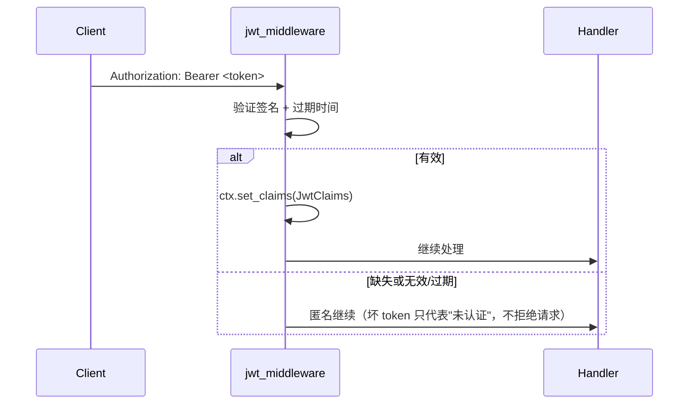

# JWT Bearer 认证

## 一行启用

```rust
Host::builder().add_authentication().build().run().await?;
```

自动：
1. 从 `appsettings.json` 读取 `Jwt.Secret`
2. 注册 `jwt_middleware`

`add_authentication()` 只负责 JWT 认证；`#[authorize]` 规则由端点自己执行，未满足时返回 401/403（见 [authorize 宏](authorize-macro.md)）。旧的 `.use_resource_authorization()` 已过时，无需调用。

## 配置

```json
{
  "Jwt": {
    "Secret": "your-256-bit-secret-change-in-production"
  }
}
```

## 认证流程



是否返回 `401` 由**端点保护**决定：`#[authorize]` 或必填 `#[fromclaim] user: IdentityUser`
在认证失败时统一 401；公开端点（登录、健康检查、配置）即使客户端带着过期 token 也能正常处理——
否则登录接口会被旧 token 锁死。

所有 `401` 由 host 统一写出：`application/problem+json` + `WWW-Authenticate: Bearer realm="rust-webx"`（RFC 7235 要求 401 必须带挑战）。
`detail` 面向客户端：未认证统一为 `authentication required`；token 解码器的具体原因（`InvalidToken`、过期、签名）只进 `tracing::debug!` 日志。

## 在 Handler 中读取身份

首选把身份声明为 Request 字段，Handler 不接触 `IHttpContext`（见[用户身份与多租户](../05-request-pattern/user-identity.md)）：

```rust
#[derive(WebxRequestMeta)]
pub struct MeRequest {
    #[fromclaim]
    pub user: IdentityUser,   // 未登录 → 401
}

#[get("/api/me")]
impl IRequest<UserView> for MeRequest {}

// Handler
let user = req.require_user()?;
println!("{} / {:?}", user.id, user.roles);
```

只有需要完整 claim map 的高级场景才直接读上下文：

```rust
let claims = ctx.claims().unwrap();
println!("User: {}", claims.subject());
```

## 签发 Token

框架提供 `jwt_secret()` 获取当前签名密钥；shim 的初始化与使用约定见[安全最佳实践](security-best-practices.md#jwt_secret-进程级-shim)：

```rust
use jsonwebtoken::{encode, EncodingKey, Header};

let token = encode(
    &Header::default(),
    &claims,
    &EncodingKey::from_secret(jwt_secret().as_bytes()),
)?;
```

Docbit 的 `LoginHandler` 是完整示例。

## 小结

`add_authentication()` + `Jwt.Secret` 配置即可启用 JWT 认证。业务代码优先通过 Request 的
`IdentityUser` 字段拿身份，而不是直接操作 `IHttpContext`。

下一节：[基于资源的授权](resource-authorization.md)
