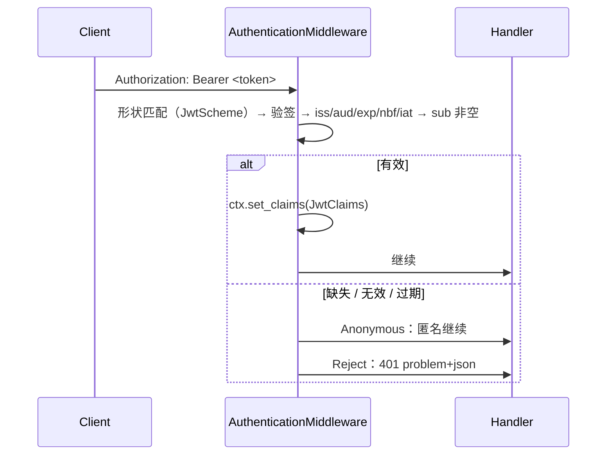

# JWT Bearer 认证

## 一行启用

```rust
Host::builder().use_authentication().build().run().await?;
```

自动：
1. 从 `appsettings.json` 读取 JWT 配置（`Jwt` 节，详见下表）
2. 注册 JWT scheme（由 `AuthenticationMiddleware` 统一调度）
3. 注册默认 `ITokenIssuer`（HS256，登录端点注入即可签发）

`use_authentication()` 只负责 JWT 认证；`#[authorize]` 规则由端点自己执行，未满足时返回 401/403（见 [authorize 宏](authorize-macro.md)）。需要与 `sk-` API Key 共存时见 [API Key 认证](api-key-auth.md)。

## 配置

```json
{
  "Jwt": {
    "Secret": "",
    "SecretFile": "data/jwt.key",
    "ExpirationMinutes": 60,
    "Issuer": "https://id.example.com",
    "Audience": "travel-api",
    "Algorithms": ["HS256"],
    "ClockSkewSeconds": 30,
    "InvalidTokenBehavior": "Anonymous",
    "MaxTokenBytes": 8192
  }
}
```

| 键 | 默认 | 含义 |
|---|---|---|
| `Secret` / `SecretFile` | 空 | HS256 密钥；优先级 `APP__Jwt__Secret`/`JWT_SECRET` > `Secret` > 文件内容 |
| `ExpirationMinutes` | 60 | 默认 issuer 的 token 寿命（`0` 回退默认） |
| `Issuer` | 未设置 | 设置后 `iss` 必须精确匹配 |
| `Audience` | 未设置 | 设置后 `aud` 必须包含该值 |
| `Algorithms` | `["HS256"]` | 接受 `HS256`/`RS256`/`ES256`/`PS256`；非对称算法必须同时配置 `Jwks` |
| `ClockSkewSeconds` | 30 | `exp`/`nbf`/`iat` 的时钟偏移，上限 300 |
| `InvalidTokenBehavior` | `Anonymous` | `Anonymous` = 坏 token 当未登录；`Reject` = 直接 401 |
| `MaxTokenBytes` | 8192 | 超过上限在验签前拒绝，防大 header 分配 |
| `Jwks.Url` | 未设置 | 非对称验签的 JWKS 地址，必须 `https://` |
| `Jwks.CacheSeconds` | 300 | 已取回 JWKS 的缓存时间（1–86400） |
| `Jwks.TimeoutMs` | 2000 | 单次拉取超时（100–10000） |
| `Jwks.MaxKeys` | 32 | 单文档最多使用多少把 key（1–256） |
| `Jwks.AllowPrivateNetworks` | false | 允许内网 JWKS（显式 opt-in；默认拒绝私网/元数据地址） |

另有四组键只在下文对应小节展开：`Jwt.Signing` + `Jwt.RetiredSigningKeys`（非对称签发与
JWKS 发布）、`Jwt.Issuers`/`Jwt.Audiences`/`Jwt.JwksSources`（多 issuer 资源服务器）、
`Jwt.RequireScope`/`Jwt.ScopeAsPermissions`/`ScopeClaim`/`ScopeSeparator`（scope）。

配置是 **fail-closed** 的：空 `Issuer`/`Audience`、host 不支持的算法、`ClockSkewSeconds > 300`、`MaxTokenBytes` 为 0 或超过 1 MiB，都会在启动期以 typed error 终止，而不是静默回退。

代码里需要覆盖时：

```rust
Host::builder()
    .use_authentication()
    .use_jwt_validation(
        JwtValidation::builder()
            .require_issuer("https://id.example.com")
            .require_audience("travel-api")
            .invalid_token_behavior(InvalidTokenBehavior::Reject)
            .leeway(Duration::from_secs(30))
            .max_token_bytes(8 * 1024)
            .build()?,
    )
    .build();
```

## 非对称验签与 JWKS

```json
{
  "Jwt": {
    "Secret": "",
    "Algorithms": ["RS256", "ES256"],
    "Issuer": "https://id.example.com",
    "Audience": "travel-api",
    "Jwks": {
      "Url": "https://id.example.com/.well-known/jwks.json",
      "CacheSeconds": 300,
      "TimeoutMs": 2000,
      "MaxKeys": 32
    }
  }
}
```

- 令牌头 `alg` 必须在 `Algorithms` 白名单内；`kid` 交给 `IJwtKeyResolver`。
- `JwksResolver`：缓存已取回的 key；未知 `kid` **只触发一次**刷新（单飞），仍未知 → 401；拉取失败/文档无可用 key → **503 fail-closed**，不会降级成匿名。
- JWKS 文档只接受 `RSA`/`EC(P-256)` 且 `use` 为 `sig`（或缺省）的 key；`alg` 与 `kty` 不符的条目会被跳过。文档大小上限 512 KiB，key 数有上限。
- 拉取走 `rust-webx-client`，默认 SSRF 守卫（私网/链路本地/元数据地址被拒）；`Jwks.Url` 必须 HTTPS。
- HS256 与 JWKS 可共存：`Algorithms: ["HS256","RS256"]` 时，HS256 用 `Jwt.Secret`，RS256/ES256 用 JWKS。
- 纯 JWKS 部署（`Algorithms` 无非对称以外）不需要 HMAC secret；Production 弱密钥守卫只对 HS256 生效。

## 非对称签发与 JWKS 发布

`Jwt.Signing` 让本服务用自己的私钥签发、把公钥发布成标准 JWKS：其它资源服务器只持公钥即可
验签，HS256 共享密钥不再是跨服务必需品。未配置 `Jwt.Signing` 时行为与之前完全一致。

```json
{
  "Jwt": {
    "Algorithms": ["RS256"],
    "Issuer": "https://auth.example.com",
    "Audience": "travel-api",
    "Signing": {
      "Algorithm": "RS256",
      "KeyId": "2026-11-a",
      "PrivateKeyFile": "/run/secrets/jwt-signing.pem",
      "PublicKeyFile": "/run/secrets/jwt-signing.pub.pem"
    },
    "RetiredSigningKeys": [
      {
        "KeyId": "2026-10-a",
        "Algorithm": "RS256",
        "PublicKeyFile": "/run/secrets/jwt-signing-2026-10.pub.pem"
      }
    ]
  }
}
```

| 键 | 必填 | 含义 |
|---|---|---|
| `Signing.Algorithm` | 是 | `RS256`/`ES256`/`PS256`；`HS256` 留在 `Jwt.Secret`，在这里被拒绝 |
| `Signing.KeyId` | 是 | JWT header `kid`，同时是 JWKS 条目的 `kid` |
| `Signing.PrivateKeyFile` | 是 | PKCS#8/PKCS#1/SEC1 PEM 私钥；Unix 上必须 `chmod 600` |
| `Signing.PublicKeyFile` | 否 | 只用于核对私钥；缺省时从私钥派生公钥 |
| `Signing.Issuer` | 否 | 多 issuer 部署下本机自签所用的 `iss`，必须出现在 `Jwt.Issuers`；单 issuer 时沿用 `Jwt.Issuer` |
| `RetiredSigningKeys[].KeyId` | 是 | 只验签的旧公钥 `kid`，不得与 active 或彼此重复 |
| `RetiredSigningKeys[].Algorithm` | 是 | 旧 token 的算法；必须在 `Jwt.Algorithms` 内 |
| `RetiredSigningKeys[].PublicKeyFile` | 是 | PEM 公钥（永远不用于签发） |

启动期 fail-closed（任一不满足即启动失败，不静默回退）：

- `Jwt.Algorithms` 不含 `Signing.Algorithm` 或某个 retired key 的算法；
- `KeyId` 空白/超长/含空白字符，retired `kid` 与 active 或彼此重复；
- 私钥文件读不到，或 Unix 权限不是 `0600`；
- RSA 模数小于 2048 位，EC 不是 P-256，算法与密钥类型不符；
- `PublicKeyFile` 与私钥不匹配；
- 启动自检失败：用 active key 签一份短命 token，再用 `verification_resolver()` 验回。

装配规则（`Host::build()`，`use_authentication()` 启用认证）：

1. 配了 `Jwt.Signing` → 启动期加载密钥集，注册 `Arc<JwtKeySet>` 单例与非对称 `ITokenIssuer`；
2. 既没有 `Jwt.Jwks` 也没有 `Jwt.JwksSources` → 验签用本地 key set（自签自验闭环，启动不触网）；
3. 同时配了 `Jwt.Signing` 与远端来源（`Jwt.Jwks`/`Jwt.JwksSources`）→ 本地 `kid` 优先命中，
   未知 `kid` 才查询远端：合作方 IdP 故障不会连带拒绝本机签发的 token，远端多来源仍保持
   "同一 `kid` 命中多源 → 503" 的 fail-closed 语义。

发布端点不需要自己拼 JSON：`JwkSet` 已实现 `Serialize`，当作普通 DTO 返回即可
（编译门禁示例：[`crates/webx/examples/asymmetric_jwt.rs`](../../../crates/webx/examples/asymmetric_jwt.rs)，
登录 → `/api/me` → JWKS 全链路）。

```rust
use std::sync::Arc;
use webx::*;

#[get("/.well-known/jwks.json")]
impl IRequest<JwkSet> for JwksRequest {}

#[derive(Inject)]
pub struct JwksHandler {
    #[inject]
    keys: Arc<JwtKeySet>, // Jwt.Signing 配置时由 Host::build() 注册
}

#[handler(inject)]
#[async_trait::async_trait]
impl IRequestHandler<JwksRequest, JwkSet> for JwksHandler {
    async fn handle(&mut self, _req: JwksRequest) -> ActionResult<JwkSet> {
        // active + retired，只含公钥参数（RSA n/e、EC x/y），永不含 d
        Ok(self.keys.jwks())
    }
}
```

- 端点本身不需要鉴权（公钥是公开信息）；发布是静态快照，换 key 走滚动部署，没有运行期热轮换。
- 签发仍走同一端口，Handler 不接触私钥：`Arc<dyn ITokenIssuer>` 在 `Jwt.Signing` 下按
  `alg` + `kid` 签 `RS256`/`ES256`/`PS256`。
- 想在自己的代码里构造公钥条目（例如导给别的服务）：`Jwk::from_public_key_pem(alg, kid, pem)`
  生成 JWK，`StaticKeyResolver::new().with_jwk(&jwk)?` 做验签器。

判定与边界见 [federated-auth.md](../../design/federated-auth.md)。

## 多 issuer / 多 audience

同一个服务可以同时信任自有 IdP 与企业 IdP：`Issuers`/`Audiences` 是 `Issuer`/`Audience` 的
表形式，每个 issuer 各自绑定一个 JWKS 来源。

```json
{
  "Jwt": {
    "Algorithms": ["RS256", "ES256"],
    "Issuers": ["https://auth.example.com", "https://login.partner.example"],
    "Audiences": ["travel-api", "travel-api-partner"],
    "JwksSources": [
      {
        "Issuer": "https://auth.example.com",
        "Url": "https://auth.example.com/.well-known/jwks.json"
      },
      {
        "Issuer": "https://login.partner.example",
        "Url": "https://login.partner.example/.well-known/jwks.json",
        "CacheSeconds": 120,
        "MaxKeys": 8
      }
    ]
  }
}
```

互斥与校验（都在启动期，失败即启动失败）：

- `Issuer` 与 `Issuers` 互斥，`Audience` 与 `Audiences` 互斥：一个信任列表不给两种写法。
- `Jwks` 与 `JwksSources` 互斥；`JwksSources` 不配任何 issuer 信任列表（`Issuer` 或 `Issuers`）
  也是错误——每个来源必须绑定一个已信任的 issuer。
- `JwksSources[].Issuer` 非空、唯一且出现在 `Jwt.Issuers` 中；每个来源的 `Url` 必须 `https://`，
  `CacheSeconds` 1–86400、`TimeoutMs` 100–10000、`MaxKeys` 1–256（与 `Jwt.Jwks` 同规则）。

判定语义：

- `iss` 必须等于列表中的某一个（any-of）；`aud` 必须**包含**列表中的某一个；未配置对应列表则不校验。
- 单值写法等价于单元素列表，`JwtValidation::issuers()`/`audiences()` 返回权威列表，
  `issuer()`/`audience()` 只在恰好一个元素时返回 `Some`。
- 多源按声明顺序逐个查询：`kid` 只命中一个来源 → 用该 key；全不命中 → 401；
  **同一 `kid` 被多个来源发布 → 503**；某个来源不可达/文档损坏 → 503 fail-closed，不降级成匿名。
- **来源绑定**：`JwksSources[].Issuer` 不只是启动期校验——验签后 token 的 `iss` 必须等于实际提供
  key 的来源 issuer，否则按无效 token 处理。来源 B 的 key 签发的 token 不能冒用来源 A 的 `iss`
  去继承 A 的授权语义。只有一份共享 `Jwt.Jwks`（或本地 `Jwt.Signing`）时没有来源归属，
  `Issuers` 仅作粗粒度白名单。
- 每个来源有独立缓存、单飞刷新与未知 `kid` 限速；查询是顺序的（不并行扇出），来源数量应保持在个位数。
- 自签 token 的 `iss`/`aud`：列表恰好一个元素时按该值写入；多元素列表无法指认本机身份，
  框架不猜——需要自签非对称 token 时注册自定义 `ITokenIssuer`
  （`JwtTokenIssuer::from_key_set(...).with_issuer(..).with_audience(..)`）。

判定与边界见 [federated-auth.md](../../design/federated-auth.md)。

## scope 与 client_id

开启 OAuth 2.0 资源服务器语义：token 的 scope 参与认证与权限判定。

```json
{
  "Jwt": {
    "Algorithms": ["RS256"],
    "Issuer": "https://id.example.com",
    "Audience": "travel-api",
    "RequireScope": true,
    "ScopeAsPermissions": true
  }
}
```

| 键 | 默认 | 含义 |
|---|---|---|
| `ScopeClaim` | `scope` | 携带 scope 的 claim 名；空白即启动失败 |
| `ScopeSeparator` | 空格 | 字符串形式 scope 的分隔符；空串即启动失败 |
| `RequireScope` | false | 为 `true` 时，没有任何 scope 的 token 直接 403 |
| `ScopeAsPermissions` | false | 为 `true` 时把 scope 并入 `permissions()` |

- 两种线上形式都接受：字符串 `"orders.read orders.write"`（按 `ScopeSeparator` 切分），或数组
  `["orders.read","orders.write"]`。每项 trim、丢弃空项、按出现顺序去重。
- 两个开关**互相独立**：
  - 只开 `RequireScope`：scope 只回答"这个 token 有没有拿到任何 scope"，`permissions()` 不变；
  - 只开 `ScopeAsPermissions`：scope 并入权限，但不要求 token 必须带 scope；
  - 都开（典型资源服务器）：必须有 scope，且 scope 名可直接被 `#[authorize(permission = "…")]` 匹配。
- 开 `ScopeAsPermissions` 后，scope 追加在 token 自带 `permissions` 之后并去重：
  `permissions: ["orders.read"]` + scope `["orders.read","orders.write"]` →
  `["orders.read","orders.write"]`。
- scope **不**进 `roles`：OAuth scope 不是角色。
- 默认关闭 `ScopeAsPermissions` 的理由：外部 IdP 的 `scope` 不应静默放大应用自己声明的权限面。
- `RequireScope = true` 且 token 没有 scope → **403**（不是 401）：凭证是真的，只是够不到任何 scope；
  重试同一凭证没有意义，`InvalidTokenBehavior::Anonymous` 也不会把"没 scope"降级成"未认证"。
- `RequireScope = false` 时无 scope 的 token 照常通过。

`IdentityUser` 增加 `client_id`，取自 `client_id` claim，缺失时回退 `azp`（OIDC 的 authorized
party），都没有则为空串。它用于按客户端审计/分策略，**不是**权限来源：

```rust
#[derive(WebxRequestMeta)]
pub struct AuditRequest {
    #[fromclaim]
    pub user: IdentityUser, // user.client_id：哪个客户端拿到的凭证
}
```

判定与边界见 [federated-auth.md](../../design/federated-auth.md)。

## 认证流程



- **`Anonymous`（默认）**：坏 token 只代表"未认证"，公开端点（登录、健康检查、文档）不会被旧 token 锁死；受保护端点由 `#[authorize]` 或必填 `#[fromclaim]` 统一 401。
- **`Reject`**：OAuth 2.0 资源服务器语义——显式出示坏凭证立即 401，不再降级为匿名。
- **吊销永远 401**：命中 `ISessionStore` 的 `jti` 时，两种模式都是 401（凭证问题，不是匿名）。
- **空 `sub` 永远拒绝**：签过名但没有主体的 token 不会成为 `IdentityUser`（否则租户/归属校验会面对幽灵主体）。
- 所有 401 由 host 统一写出：`application/problem+json` + `WWW-Authenticate: Bearer realm="rust-webx"`（RFC 7235 要求 401 必须带挑战）。`detail` 面向客户端统一为 `authentication required`；具体原因（`InvalidToken`、过期、签名）只进 `tracing::debug!`。

## 在 Handler 中读取身份

首选把身份声明为 Request 字段，Handler 不接触 `IHttpContext`（见[用户身份与多租户](../05-request-pattern/user-identity.md)）：

```rust
#[derive(WebxRequestMeta)]
pub struct MeRequest {
    #[fromclaim]
    pub user: IdentityUser,   // 未登录 → 401
}

#[get("/api/me")]
impl IRequest<UserView> for MeRequest {}

// Handler
let user = req.require_user()?;
println!("{} / {:?}", user.id, user.roles);
```

只有需要完整 claim map 的高级场景才直接读上下文（中间件/基础设施层）：

```rust
let claims = ctx.claims().unwrap();
println!("User: {}", claims.subject());
```

## 签发 Token

登录端点注入框架端口，不要手写 `jsonwebtoken`：

```rust
// Handler 注入：Arc<dyn ITokenIssuer>（host 已按 Jwt.Secret/Issuer/Audience 注册默认实现）
let issued = self.tokens.issue(
    TokenClaims::new(&user.id)
        .with_roles(&user.roles)
        .with_claim("tenant_id", &user.tenant_id),
).await?;
// issued.token / issued.jti / issued.expires_at_unix_secs（秒）
```

默认 issuer 会把配置里的 `Issuer`/`Audience` 写入 token，因此启用 `iss`/`aud` 校验后，本 host 自己签发的 token 仍然有效。配置 `Jwt.Signing` 时同一端点改签非对称 token（`alg` + `kid`，见上文「非对称签发与 JWKS 发布」），业务代码不变。自定义 issuer 用 `register_with_options` 读取 `options.jwt.secret` 的最终值（`Jwt.SecretFile` 已解析）。

## 小结

> 2.5 的全局签名密钥 shim（`init_jwt_secret` / `jwt_secret()`）已在 2.9.1 删除，没有替代的 <!-- docs:allow-stale-api -->
> 全局入口。密钥只存在于配置与 DI：`Jwt.SecretFile`（解析顺序 env > `Jwt.Secret` > 文件，启动期
> 解析为 `webx::JwtSecret`）；自定义 issuer 用 `HostBuilder::register_with_options(|svc, options| …)`
> 读 `options.jwt.secret`。业务代码注入 `Arc<dyn ITokenIssuer>` 并调用 `issue(TokenClaims)`，
> 不要读取或保存密钥本身。迁移细节见 [upgrade-to-2.9.1](../16-migration/upgrade-to-2.9.1.md)。

`use_authentication()` + `Jwt` 配置即可启用 JWT 认证；当前 `iss`/`aud`/算法/时钟偏移/令牌上限/严格模式全部可配且 fail-closed。业务代码优先通过 Request 的 `IdentityUser` 字段拿身份，登录/登出通过 `ITokenIssuer`/`ISessionStore` 端口。

### 按路径限定 scheme（可选）

全局 scheme 链之外，可对路径前缀限定允许的 scheme（首个匹配前缀生效）：

```rust
Host::builder()
    .add_authentication_scheme(Arc::new(MtlsScheme::new(resolver)))
    .use_authentication() // JWT
    .use_auth_scheme_for("/mtls", ["mtls"]) // /mtls 只接受 mTLS
    .build();
```

- 未匹配路径保持完整链；匹配路径只尝试允许的 scheme（按路径段边界匹配，`/mtls` 不会捕获 `/mtlsx`）；
- 没有允许凭证时按匿名继续，受保护端点仍由 `#[authorize]`/身份绑定返回 401；
- 用于 `per-route scheme`，不要用它替代授权。

下一节：[资源授权与实例级归属](resource-authorization.md)
